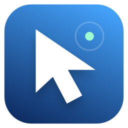

# Fluid Control



An experimental macOS app that turns camera-tracked hand movement into pointer control. Built for playful, low-effort interaction and quick personal calibration.

**Status: prototype, version 0.8.2.** Pointer control has been used interactively, but gesture shortcuts, distant tracking, rotated hands, and compatibility across games and popups still need live validation. This source publication does not certify those features as reliable.

The native app currently appears as **Control**. Keeping that internal name and bundle identifier preserves continuity with earlier local builds; this public edition is called **Fluid Control**.

## Current usability status

**Not reliable yet.** The user reports inability to select a feedback answer at approximately two feet. The required operating distance is 5–10 feet, and that requirement has not been demonstrated. Track [blocking issue #1](https://github.com/cjschaffer14-web/fluid-control/issues/1). See the [failure and judgment review](docs/reviews/2026-10-27-usability.md) before interpreting tests or the tracking halo as acceptance evidence.

## Fluid simplification in 0.8.2

The 0.8.1 recovery disabled scrolling and desktop finger shortcuts. This left the requested controls unavailable. In 0.8.2 they are enabled again by **Fluid pointer**, with recognition running alongside pointing: an uncompleted finger chord no longer reserves, cancels or rearms the pointer.

Fluid mode now follows a visible palm immediately, without waiting for click arming or treating a fist/thumb posture as rest. An unused fingertip at the image edge no longer stops pointing. Hidden thumb/index tips disable clicking and release an existing drag; loss of the palm still stops output and releases buttons. Show thumb/index and release the pinch to arm clicks again.

To reduce competing interpretations, Fluid mode drops the two-finger double-click chord and automatic open-hand room recall. Double click uses two ordinary pinches. Two fingers are for a vertical scroll flick; exactly three visible fingers are for a horizontal desktop swipe. Briefly relax those fingers between strokes. Tilt remains an explicit opt-in. Manual position save/recall and other schemes remain available.

The ring and click sound remain. Local shortcut diagnostics now distinguish disabled controls, paused control, mouse handoff, pinch held, hidden gesture fingers and tracking loss. No live trial yet establishes that these recognition changes work at 5–10 feet.

## Recovery in 0.8.1 (historical)

A regression in 0.8 silently enabled tilt for older profiles. Once the hand settled, tilt replaced ordinary translation and suppressed smaller movements. Fluid mode also multiplied pointer gain by apparent distance, changing an earlier usable response. The recovery removes that multiplier and makes tilt opt-in.

In 0.8.1, **Fluid pointer** restored ordinary translation pointing with tilt and finger shortcuts off. It keeps your calibration and sensitivity, releases any held drag, and saves the first pre-recovery profile locally. **Tilt ON/OFF** explicitly selects the experimental rotation mode without competing finger shortcuts. Double click, scrolling and desktop chords remain separate menu opt-ins; their recognition is still unresolved. The local recovery updater starts the camera and pointer through the existing permissions.

The halo and click sound remain. Camera-off status clears stale frame-rate telemetry. Injected events carry a process-local ownership tag so source-PID-zero routes can be distinguished from untagged physical mouse events. This is defensive hardening; logs did not prove a self-triggering takeover loop.

## Introduced in 0.8.0

- A non-interactive halo follows the active window: white means tracked but paused/resting/not armed, green means ready or tilt precision, amber means insufficient detail/partial hand/delay, and red means the hand is lost. It does not detect eye gaze. Toggle it from Control's menu.
- A stationary hand can enter wrist-tilt precision after settling; small rotations provide fine adjustment, and larger hand travel returns to coarse control. This remains an unvalidated usability experiment, with entry reasons exposed in diagnostics.
- Smaller hand crops and lower-frame search tiles target distant tracking. Gesture thresholds scale with visible hand size. These changes do not create sensor detail or prove operation at a physical distance.
- Desktop finger chords now use exactly **three extended fingers**. An open palm remains available for pointing/tilt and saved-position waving.
- The 5–10 ft trial records tracking losses and asks for the user's actual distance. Feedback through text is valid when the selection interface fails.

## Changes introduced in 0.7.0

- Scrolling measures index/middle fingertip movement, so the palm can stay still. Brief finger-shape fluctuations are tolerated and diagonal desktop sweeps need less rigid alignment.
- Fluid mode preserves enabled desktop shortcuts. With saved room positions, use **three fingers** for desktops; a four-finger open-hand wave is reserved for position recall.
- The preview draws all 21 joints, including the thumb, with an inset showing estimated 3D geometry. Finger curls and a palm coordinate frame use the model's world landmarks when available. Camera depth remains an estimate; occluded joints can be wrong.
- Actual mouse presses have a short generated acoustic tap. Toggle **Click sound on / off** in Control's menu. It mixes with existing audio; it does not change the volume of other applications or provide physical haptics.

## Room positions and calling Control

This is a map of saved camera positions and relative hand size, **not a scan of walls or furniture**. Keep the camera fixed. In each comfortable seated or standing location, choose **Save position here** from Control’s menu, then hold an open hand still for about one second. Up to eight positions retain the current profile. Use **Room map** to see them.

Wave an open hand back and forth with three direction changes to recall a matching profile and resume at the current cursor. A single sweep is not a recall wave. Ambiguous or unmatched positions do not load a profile; the app asks you to save a position. Apparent hand size varies with orientation, so use a similar relaxed open hand when teaching and recalling positions. Moving the camera invalidates the map: save positions again. Save a position again after tuning its profile.

Press **Voice** and say “calibrate here” to save a position or “Control” to recall it. Optional **Listen for “Control” on / off** enables local microphone listening for this session. It is off at launch. While waiting, only a sufficiently confident exact “Control” result opens an eight-second command window; it also tries to recall your position. Commands such as “calibrate here” can then be spoken. Camera tracking must see your hand to save or recall. A webcam does not locate a voice in the room. Wake recognition is experimental and may miss speech or respond incorrectly in background audio. Turn it off from the menu to close wake listening.

Room anchors store camera-relative hand location, relative size, handedness and profiles locally under application support. No room imagery is saved. Separate camera selections use separate anchor files. To reset a map, quit Control and remove the corresponding `room-positions*.json` file there. Microphone audio is processed locally and is not saved.

## What is here

- Camera-based pointer with adaptive smoothing, hand-size-aware tracking and a distance search pass.
- Finger and whole-hand control schemes, plus a Fluid pointer mode.
- Pinch click and drag, and native window movement and resizing modes.
- Experimental two-finger curl/reopen for double click in the other schemes, two-finger vertical flick for scrolling, and exactly-three-finger horizontal swipe for switching desktops.
- Guided live demos: attempt recording, five feedback questions, and profile adjustments for the next round.
- Optional local voice commands, a native Dock icon and a macOS permission panel.

Actual behavior depends on the selected mode and shortcut settings. A two-finger tap means curling and reopening the two fingers in camera view; it is not contact with a physical surface. Use the app's camera preview and demo feedback to check recognition before relying on a gesture.

## Build on your Mac

Requires macOS 14 or later, a camera, Xcode Command Line Tools (`xcode-select --install`), and a Python installation with a loadable shared library or framework. The development environment was tested with Python 3.15 and the exact versions in `requirements.txt`; other combinations have not been verified.

```sh
python3 -m venv .venv
source .venv/bin/activate
python -m pip install -r requirements.txt
mkdir -p models
curl -fL https://storage.googleapis.com/mediapipe-models/hand_landmarker/hand_landmarker/float16/1/hand_landmarker.task -o models/hand_landmarker.task
python build.py
open dist/Control.app
```

The build script discovers the active Python runtime, generates the icon, bundles the app's Python sources and the supplied hand model, and signs the result ad hoc. It does not download dependencies or models. Use `python build.py --help` for model and output options.

**This build uses the Python environment on the machine where it was built.** Keep that interpreter and virtual environment in place. Copying the `.app` to another Mac is not a supported distribution method. A standalone, notarized installer is not included.

For optional speech, install `requirements-voice.txt`, obtain the [Vosk small English model](https://alphacephei.com/vosk/models), and build with `--speech-model /path/to/vosk-model-small-en-us-0.15`. Voice is activated explicitly in the app.

## First run and controls

1. Open Control and grant Camera and Accessibility access when prompted. Microphone is needed only for optional voice input.
2. Confirm that the preview sees your hand, choose a scheme and calibrate your comfortable movement range.
3. Start with a guided Live demo. Complete the requested action and answer its five questions to tune the next attempt.
4. Enable and test gesture shortcuts separately. Desktop switching also depends on macOS Spaces settings.

Escape pauses control. Physical mouse input temporarily yields gesture control and then resumes it. Lower or remove the hand if recognition becomes uncertain. Window actions depend on the target application's accessibility support; Steam and game overlays may behave differently from ordinary macOS windows.

For source development, set `CONTROL_HAND_MODEL` to the model path and run `python src/app.py`; permissions may then belong to the launching interpreter or terminal. Use the bundled launcher for consistent app identity.

## Privacy and local data

Camera frames are processed locally. The application code does not upload video or audio, and guided trials do not save raw media. Optional voice recognition uses a local Vosk model. Installing dependencies and downloading models require network access.

Profiles and launch logs are stored in `~/Library/Application Support/Control`. Guided trials save timestamps, derived hand signals, pointer coordinates, event timing, task outcomes, configuration and your written feedback. Source runs put trials in `attempts/`; packaged runs use the application-support directory. These records can contain personal information. They are ignored by Git and are not included in this repository.

`CONTROL_DATA_DIR` overrides the runtime profile/log directory. It does not override the native launcher's log or the guided trial directory. Delete the corresponding local files to remove those records.

## Development and validation

```sh
python -m unittest discover -s tests -v
python build.py --model /path/to/hand_landmarker.task
codesign --verify dist/Control.app
```

See [VALIDATION.md](VALIDATION.md) for what the automated checks cover and the live checks still needed. See [THIRD_PARTY.md](THIRD_PARTY.md) for model and dependency sources. No model binaries, personal trials, calibration profiles, recordings, or machine-specific app bundles are distributed here.
